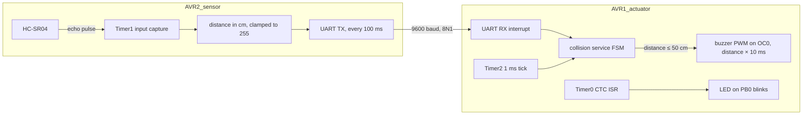

# ASURT collision avoidance (ATmega32)

Two-microcontroller ultrasonic collision-warning system written in bare-metal embedded C for the ATmega32. It was built as a recruitment task for the **Ain Shams University Racing Team (ASURT) low-voltage team** (FSUK26 season) and simulated in Proteus.

**Author:** Abdelrahman Sherif

## How it works



Both MCUs run at 16 MHz. Each project uses a three-layer layout: `drivers/` (peripherals), `services/` (UART and application logic) and `src/main.c`.

| MCU | Role | Peripherals |
|---|---|---|
| AVR2_sensor | Measures distance and sends one byte per reading | HC-SR04 (TRIG PA6, ECHO PA5), Timer1 input capture, UART TX |
| AVR1_actuator | Receives the distance and drives the warnings | UART RX interrupt, Timer0 (LED blink / buzzer PWM on PB3), Timer2 1 ms tick |

## Repository layout

```
AVR/
├── AVR1_actuator/             Eclipse AVR project: UART RX, buzzer FSM, LED
│   ├── drivers/actuator_drivers.[ch]
│   ├── services/collision_service.[ch], uart_rx_service.[ch]
│   └── src/main.c
├── AVR2_sensor/               Eclipse AVR project: HC-SR04 + UART TX
│   ├── drivers/hcsr04_driver.[ch]
│   ├── services/uart_tx_service.[ch]
│   └── src/main.c
└── collision avoidance.pdsprj Proteus simulation of both MCUs
```

## Build and simulate

1. Import `AVR/AVR1_actuator` and `AVR/AVR2_sensor` into Eclipse with the AVR Eclipse plugin (target: ATmega32, 16 MHz), or build with `avr-gcc -mmcu=atmega32 -DF_CPU=16000000UL -Os`.
2. Open `AVR/collision avoidance.pdsprj` in Proteus and load each `.hex` into its MCU.

## Known limitations

The code is kept as submitted for the task. Points to fix before using it on hardware:

- **Timer0 conflict:** `led_init()` configures Timer0 in CTC mode for the LED, then `buzzer_init()` reconfigures the same timer for fast PWM. Only one of the two functions can work at a time. The LED needs to move to another timer.
- The Timer1 (sensor) and Timer2 (`millis()`) clock-select bits are never set, so neither timer runs as written.
- ATmega32 input capture uses ICP1 (PD6). The echo pin is configured as PA5.

## License

MIT. See [LICENSE](LICENSE).
