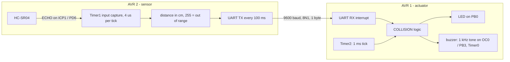

# ASURT collision avoidance (ATmega32)

Two-microcontroller pre-crash warning system in bare-metal embedded C for the ATmega32, built with PlatformIO. It was my individual solution to the **Low Voltage solo mission (FSUK26)** of the **Ain Shams University Racing Team (ASURT)**.

**Author:** Abdelrahman Sherif

## Task

Two AVRs talk over UART. AVR 2 reads an ultrasonic sensor; AVR 1 drives an LED and a buzzer. When the measured distance is **≤ 50 cm**:

- the LED toggles every 0.5 s;
- the buzzer is switched on for 10 × distance ms, then off for the same time (50 % duty cycle). At 45 cm, for example, it is on for 450 ms and off for 450 ms.

## How it works



| Board | Pins | Timers |
|---|---|---|
| AVR 2, sensor | TRIG PA6, ECHO PD6 (ICP1), TXD PD1 | Timer1: echo width by input capture, 40 ms timeout |
| AVR 1, actuator | RXD PD0, LED PB0, buzzer PB3 (OC0) | Timer0: buzzer tone · Timer2: 1 ms system tick |

Both boards run at 16 MHz. Each timer has exactly one owner. The warning logic (`src/APP/COLLISION`) has no hardware access, so it can be unit-tested on a PC. The warning also stops if no reading arrives for 500 ms (lost link).

## Repository layout

The code follows the same MCAL → HAL → Service → APP layering as my [embedded-diploma](https://github.com/abdelrahmansherifmedhat1134/embedded-diploma) smart-home project.

```
platformio.ini            two environments: sensor, actuator
lib/MCAL/USART/           UART driver (shared by both boards)
lib/HAL/HCSR04/           ultrasonic sensor on Timer1 input capture
lib/HAL/LED/, BUZZER/     LED and buzzer (Timer0 tone, or plain GPIO for an active buzzer)
lib/Service/SYSTICK/      1 ms tick on Timer2
src/APP/sensor_main.c     AVR 2 application
src/APP/actuator_main.c   AVR 1 application
src/APP/COLLISION/        warning logic (thresholds in COLLISION_cfg.h)
test/host/                host unit tests with mocked AVR registers
simulation/               Proteus project
```

## Build

```bash
pio run -e sensor      # .pio/build/sensor/firmware.hex
pio run -e actuator    # .pio/build/actuator/firmware.hex
```

## Tests

```bash
sh test/host/run_tests.sh
```

The script compiles the drivers and the application logic for the PC against mocked ATmega32 registers, including a simulated Timer1 and HC-SR04 echo. It runs 74 checks:

- UART register setup (9600 baud, 8N1) and the RX interrupt;
- HC-SR04 distance from the echo width, the 40 ms timeout when there is no echo, and recovery afterwards;
- Timer0 and Timer2 configuration (1 kHz tone, 1 ms tick), with no timer shared between modules;
- the task timing: at 45 cm the LED toggles at 0, 500, 1000 … ms and the buzzer at 0, 450, 900 … ms. Also covered: the 50 cm boundary, a distance change, the obstacle leaving, link loss and 0 cm.

## Simulation

Open `simulation/collision_avoidance.pdsprj` in Proteus. Load `.pio/build/sensor/firmware.hex` into AVR 2 and `.pio/build/actuator/firmware.hex` into AVR 1, both with a 16 MHz clock. The HC-SR04 ECHO line must go to **PD6 (ICP1)**.

## Changes from the first submission

The [first commit](https://github.com/abdelrahmansherifmedhat1134/asurt-collision-avoidance-avr/tree/9eeac05) is the original Eclipse version. This version fixes:

- **Timer0 conflict:** the LED blink and the buzzer PWM both configured Timer0. The LED is now timed in software from the 1 ms tick.
- **Timers never started:** Timer1 (echo capture) and Timer2 (`millis()`) had no clock selected. Timer2 also ticked every ~10 ms instead of 1 ms.
- **Echo pin:** ECHO was read on PA5, but the ATmega32 input capture pin is PD6 (ICP1).
- **Behaviour vs. task:** the LED now blinks only within 50 cm, and the buzzer has its off phase (10 × distance ms on, then the same off).
- **Robustness:** echo timeout, no float maths, atomic access to shared ISR data, and the warning stops on link loss.
- Absolute `C:\temp\...` include paths are replaced by the PlatformIO layout.

## License

MIT. See [LICENSE](LICENSE).
